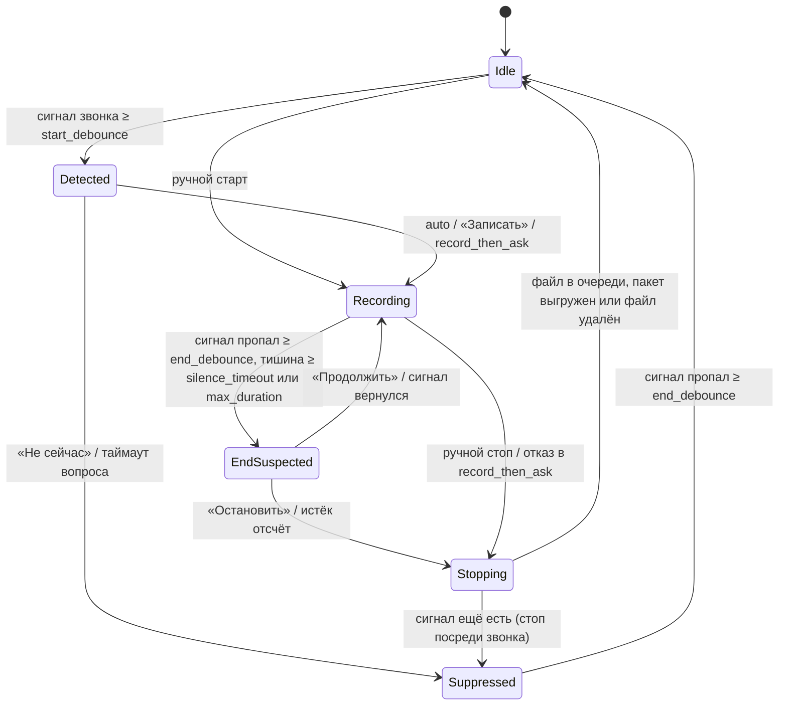

# CallScribe — ТЗ: фоновая запись, расшифровка и саммари звонков

> Рабочее название. Документ — задание на реализацию для Claude Code.
> Приоритеты: **[MVP]** — первая рабочая версия · **[v2]** — следующий этап · **[later]** — по желанию.

## 0. Указания исполнителю

- Реализуй по этапам из §12, по порядку номеров. После каждого этапа: `cargo test` и `cargo clippy` проходят, README обновлён, изменения готовы к коммиту. Коммит — только по явной просьбе пользователя.
- Платформенный код — только в крейте `callscribe-platform`, за трейтами. Ядро (правила, машина состояний, постобработка, саммари, именование) живёт в `callscribe-core` и тестируется без Tauri, OBS, GPU и нативных STT-библиотек — через трейты и фейки (§4.2).
- Глобальные настройки OBS пользователя меняй только с сохранением и последующим восстановлением.
- Если требование расходится с реальным поведением API (OBS, whisper.cpp, sherpa-onnx, Tauri, LLM-провайдеры), выбери ближайшее рабочее решение и запиши его в `docs/DECISIONS.md`.

## 1. Назначение

Фоновое приложение в трее. Замечает начало звонка (в десктопном клиенте или во вкладке браузера) и пишет видео и звук через OBS. После звонка локально расшифровывает запись, делает саммари через LLM, предлагает название и раскладывает файлы по папкам.

**Основной сценарий**

1. Приложение в трее, OBS запущен свёрнутым (если нет — приложение запускает его само).
2. Открылось окно встречи (Zoom, Teams, Webex, Google Meet) или какое-то приложение заняло микрофон (Telegram, Discord, браузер…) → через ≤ 5 с оверлей: «Звонок в Zoom — записать?».
3. «Только звук» или «Звук + экран N» (или правило «всегда записывать» с режимом по умолчанию) → OBS пишет; на экране небольшая плашка с таймером и кнопкой «Стоп».
4. Микрофон освобождён или долгая тишина → «Звонок закончился? Остановлю через 30 с» → запись остановлена.
5. В фоне (на этой машине или [v2] на другой, §5.13): извлечение дорожек → расшифровка с разделением «Я / Собеседник» → саммари → предложение названия.
6. «Готово: „Обсуждение CI-пайплайна“» → [Применить] / [Изменить] → папка звонка переименована; рядом с видео лежат субтитры, транскрипт и саммари.

**Допущения по умолчанию**

- LLM — локальная (Ollama). Облачные провайдеры, в том числе DeepSeek для первого этапа (OpenAI-совместимый API, §6), включаются только явным флагом.
- Звонок ловят два источника сразу: окна и процессы встреч, захват микрофона (§5.2).
- Для всех известных приложений режим `ask`; кнопка «Всегда для X» переключает правило в `auto`.
- STT: whisper.cpp, на GPU — `large-v3-turbo`, на CPU — `medium`. Движок по умолчанию уточняется сравнением с GigaAM v3 на звонках пользователя (M1).
- Итог сборки — нативные exe и установщик (§3); Python, Node и другие инструменты разработки для работы приложения не нужны.
- Один звонок = одна папка; видео — MP4 с тремя аудиодорожками, в режиме «только звук» — M4A с теми же дорожками.

## 2. Платформы и окружение

- **Windows 10 (2004+) / 11 x64** — основная платформа; всё [MVP] делается и проверяется под неё.
- **Ubuntu 22.04 / 24.04** — [v2]: X11 — полная поддержка, Wayland — с ограничениями (§11).
- OBS Studio 30+ (встроен obs-websocket 5.3+; на машине разработки — OBS 32.1.2).
- GPU — опционально: whisper.cpp собирается с бэкендом Vulkan (любой GPU с Vulkan) или CUDA (NVIDIA); без GPU всё работает на CPU, медленнее.
- WebView2 Runtime — для окон Tauri; в Windows 11 уже есть, на Windows 10 его ставит установщик.
- Целевая машина — домашний ПК, на нём же идёт разработка: RTX 3060 Ti (8 ГБ VRAM), i5-10400F, 32 ГБ RAM, Windows 11 Pro. Модели подбираются под 8 ГБ VRAM, расшифровка и локальная LLM идут по очереди (F-59).
- Слабые машины (например, GTX 750 Ti, 2 ГБ) не целевые: для них — DeepSeek и/или режим `remote` с обработкой на домашнем ПК (§5.13).
- В простое приложение не должно заметно занимать память (§9).
- macOS не целевая, но архитектура не должна мешать её добавить.

## 3. Стек

Главное требование к стеку: приложение компилируется в нативные exe и ставится установщиком. Движки распознавания (whisper.cpp, sherpa-onnx) написаны на C/C++ и подключаются из Rust напрямую через FFI, без промежуточных процессов и интерпретаторов.

| Слой | Выбор | Зачем |
|---|---|---|
| Язык | Rust stable, edition 2024 | нативный exe; C/C++-библиотеки подключаются через FFI (`bindgen`, `cc`, `cmake`, при необходимости `cxx`) |
| Сборка | Cargo workspace (§4.2); `cargo tauri build` → NSIS-установщик | один workspace собирает трей, CLI и библиотеки; установщик кладёт exe, ffmpeg и ресурсы |
| UI: трей, оверлеи, окна | Tauri 2 (≥ 2.8; на 10.2026 — 2.12): трей и меню — нативные (`tray-icon`), окна — WebView2; фронтенд — TypeScript + Svelte 5 + Vite | HTML/CSS для оверлеев, HiDPI и тёмная тема из коробки; окна создаются по требованию |
| Плагины Tauri | `single-instance`, `global-shortcut`, `notification` (только простые уведомления), `opener`, `dialog` | F-01, F-110, открытие файлов и папок; автозапуск (F-04) — своя запись в `HKCU\…\Run` (§11, п. 37) |
| Асинхронность | tokio (он же рантайм Tauri) | OBS-клиент, HTTP, таймеры, детектор |
| Запись | OBS Studio + obs-websocket v5, крейт `obws` | видео, мультитрек и аппаратные энкодеры уже есть |
| Медиа | `ffmpeg.exe` и `ffprobe.exe` — отдельные бинарники (sidecar в установщике, иначе из PATH), вызов через `std::process::Command`; WAV — `hound` | ремукс, извлечение дорожек, метаданные; FFmpeg не нужно собирать и линковать |
| STT | whisper.cpp через `whisper-rs` (≥ 0.16, репозиторий на Codeberg); GPU-бэкенд — Vulkan (по умолчанию) или CUDA (cargo-фича) | быстрый на GPU и CPU, встроенный VAD (Silero), хороший русский |
| STT: второй движок, диаризация | официальный крейт `sherpa-onnx` (GigaAM v3, Parakeet v3, диаризация) или transcribe.cpp (`transcribe-cpp`, ggml) — выбор по итогам M1 | сильные модели для русского; диаризация без Python и pyannote.audio |
| LLM | свои адаптеры поверх `reqwest`: Ollama (нативный API), OpenAI-совместимый (DeepSeek, llama.cpp server, LM Studio…), Anthropic | провайдер переключается в конфиге; `extra_body` и режимы JSON без ограничений типизированных SDK |
| Хранилище | файлы + `meta.json` (`serde_json`); SQLite через `rusqlite` (фича `bundled`, FTS5) | `meta.json` — источник истины, БД пересобирается |
| Конфиг | TOML: `serde` + `toml` для чтения, `toml_edit` для правок из приложения; пути — `directories::BaseDirs` + своя папка (§11, п. 41) | значения по умолчанию через serde; F-17 правит конфиг, не теряя комментарии пользователя |
| Секреты | `keyring` v3 с фичей `windows-native` (§11, п. 38) | Windows Credential Manager / Secret Service |
| Windows API | `windows` (windows-rs): WASAPI-сессии, окна, процессы; `windows-registry` — реестр | микрофон, окна, процессы, автозапуск |
| Linux API [v2] | `libpulse-binding` или `pactl`, `x11rb` | PipeWire/PulseAudio, окна X11 |
| Прочее | `clap` (CLI), `tracing` + `tracing-appender` (логи), `rapidfuzz` (дедуп эха), `regex`, `globset`, `chrono`, `uuid`, `sha2`, `deunicode` (транслитерация), `thiserror` / `anyhow` | |
| Качество | `cargo test`, `clippy`, `rustfmt`; `svelte-check` | |

**Что получается после сборки** (папка программы после установки):

- `callscribe-tray.exe` — трей и оверлеи (GUI-подсистема, без консоли); ресурсы фронтенда и промпты вшиты в exe;
- `callscribe.exe` — CLI и worker-процесс (консольная подсистема);
- `ffmpeg.exe`, `ffprobe.exe`;
- DLL GPU-бэкенда: для Vulkan не нужны (`vulkan-1.dll` ставится с драйвером видеокарты), для CUDA — `cudart64_12.dll`, `cublas64_12.dll`, `cublasLt64_12.dll` (сотни МБ); DLL sherpa-onnx и ONNX Runtime — если подключён второй движок;
- модели в установщик не входят: скачиваются при первом использовании в `%LOCALAPPDATA%\CallScribe\models\`.

Почему не другое:

- **Python** (стек ТЗ v1) — нет нормального бинарника: PyInstaller собирает папку на гигабайты с CUDA-библиотеками, сборка хрупкая.
- **C#/.NET** — близкий второй: Whisper.net, LLamaSharp, sherpa-onnx, obs-websocket-dotnet, single-file publish. Но для Ubuntu UI пришлось бы делать на Avalonia, а готовые детекторы встреч (Vibe, Anarlog) написаны на Rust.
- **C++ + Qt** — те же движки напрямую, но медленнее разработка и сложнее управление зависимостями.
- **Go** — нет встраиваемого STT/LLM без cgo, слабый GUI; cgo с GPU-библиотеками на Windows — постоянная боль.
- **Electron** (как OpenWhispr) — не бинарник, а папка с рантаймом Chromium на сотни МБ; заметная память в простое.

## 4. Архитектура

### 4.1 Процессы

```
┌─ callscribe-tray.exe: UI-процесс (всегда запущен, лёгкий) ───────────────┐
│  главный поток: цикл событий Tauri — трей, меню, окна (по требованию)    │
│  tokio: Detector (опрос раз в 2 с) ──► CallStateMachine                  │
│         ObsClient (запросы + поток событий) ◄──► OBS (websocket :4455)   │
│         JobQueue (SQLite) ──► запускает worker, читает прогресс          │
│  поток COM (MTA): аудиосессии WASAPI ──► Detector                        │
└──────────────────────────────────────────────────────────────────────────┘
┌─ callscribe.exe run-queue: worker (только пока есть задания) ────────────┐
│  ffmpeg → whisper.cpp / sherpa-onnx → постобработка → LLM → файлы, meta  │
└──────────────────────────────────────────────────────────────────────────┘
Внешние: OBS Studio, ffmpeg / ffprobe, Ollama / LLM API
```

- **Два бинарника** из одного workspace: `callscribe-tray.exe` (GUI-подсистема) и `callscribe.exe` (консоль: CLI и worker). Один exe на оба случая на Windows не годится: GUI-подсистема не выводит в консоль, а консольная мелькает окном при автозапуске (§11, п. 25).
- **Всё тяжёлое** (модели, GPU) живёт только в worker-процессе. Нативный краш whisper.cpp или нехватка VRAM не роняют трей, а после выхода worker память и VRAM гарантированно свободны.
- **Запуск worker.** Трей запускает `callscribe.exe run-queue` с флагами `CREATE_NO_WINDOW` и `BELOW_NORMAL_PRIORITY_CLASS`, stdin/stdout/stderr — `Stdio::null()`, логи worker пишет в свой файл.
  - Статусы заданий и прогресс текущего шага worker пишет в SQLite (режим WAL) — это источник истины. Пока worker работает, трей читает их раз в секунду. Перезапуск трея посреди обработки поэтому штатный: прогресс просто читается заново.
  - Очередь обрабатывает только процесс, захвативший файловую блокировку `worker.lock` (`%LOCALAPPDATA%\CallScribe\`). Держатель блокировки обрабатывает всю очередь, включая `summary_pending` с истёкшим backoff.
  - Перед выходом держатель освобождает блокировку и ещё раз проверяет очередь. Если там появились задания, он пробует взять блокировку снова; не вышло — значит, очередь уже обрабатывает другой процесс. Так задание, поставленное в последний момент, не зависает.
  - Так же ведёт себя `callscribe process` (F-130): ставит задание в очередь и обрабатывает очередь сам, если взял блокировку, иначе выходит.
  - Пауза на время записи (F-51): трей ставит в SQLite флаг «идёт запись». Worker проверяет его перед каждым шагом и ждёт, а текущий шаг доделывает.
- **Окна-оверлеи** — WebView2. Они создаются при показе и закрываются после, чтобы в простое не держать процессы WebView2 (§9). Трей и меню нативные, без WebView.
- **События** obs-websocket и WASAPI обрабатываются в фоновых задачах, в окна они попадают событиями Tauri (`emit`). `InputVolumeMeters` агрегируется на месте и в UI не пробрасывается (§11, п. 14).
- [v2] Worker может работать на другой машине без UI: `callscribe worker --inbox <dir>`, тот же бинарник; обмен пакетами через синхронизируемую папку (§5.13).

### 4.2 Структура workspace

```
Cargo.toml                         # workspace
crates/
  core/          callscribe-core: без Tauri, OBS, GPU и нативных STT-библиотек
    config.rs                      # serde-модели, загрузка TOML, правки через toml_edit
    detection/rules.rs             # процесс/окно → правило
    detection/detector.rs          # объединение сигналов, debounce; сигналы — через трейты из platform_api.rs
    platform_api.rs                # трейты MicUsageProvider, WindowProvider, Autostart; реализации — в callscribe-platform
    detection/state_machine.rs     # §4.3, чистая логика; время — через трейт Clock
    pipeline/jobs.rs               # очередь, статусы, ретраи, worker.lock
    pipeline/postprocess.rs        # фильтр галлюцинаций, дедуп эха, склейка реплик
    pipeline/summarize.rs          # промпты, map-reduce, разбор JSON
    pipeline/export.rs             # transcript.md/json, .srt, summary.md, meta.json
    pipeline/naming.rs             # шаблон, санитайзинг, переименование
    llm/                           # трейт LlmProvider (async-trait); ollama, openai_compat, anthropic (reqwest)
    stt.rs                         # трейт Transcriber, типы сегментов
    storage/db.rs                  # SQLite: звонки, задания, FTS5
    prompts/                       # summary_ru.md, chunk_ru.md, reduce_ru.md — вшиты через include_str!
  media/         callscribe-media: ffmpeg / ffprobe — ожидание файла, ремукс, извлечение дорожек, чтение WAV
  stt-whisper/   callscribe-stt-whisper: Transcriber на whisper-rs; фичи vulkan | cuda
  stt-sherpa/    callscribe-stt-sherpa: GigaAM v3, Parakeet v3, диаризация (F-60, F-61)
  obs/           callscribe-obs: подключение и переподключение, команды, события, уровни звука, запуск OBS, проверка настроек
  platform/      callscribe-platform: реализации трейтов из core::platform_api
    windows/                       # аудиосессии WASAPI, реестр ConsentStore, EnumWindows, процессы, автозапуск (HKCU\…\Run)
    linux/                         # [v2]
apps/
  cli/           пакет callscribe-cli, [[bin]] name = "callscribe" → callscribe.exe:
                 clap — process | resummarize | doctor | reindex | run-queue | cleanup | [v2] worker, export
    tests/                         # интеграционные тесты пайплайна, fixtures/
  tray/          пакет callscribe-tray → callscribe-tray.exe: Tauri 2
    src-tauri/                     # Rust: трей, окна, связывание детектора, OBS и очереди; tauri.conf.json, иконки
      binaries/                    # sidecar: callscribe, ffmpeg, ffprobe с суффиксом target triple (§11, п. 31)
    ui/                            # Svelte + TypeScript: overlay, pill, end-prompt, naming, done, error; [v2] settings, history
docs/DECISIONS.md
```

- `callscribe-core` компилируется и тестируется быстро: в нём нет CMake, CUDA и WebView. Нативные движки изолированы в `stt-*`, платформенный код — в `platform` (зависит от `core`, не наоборот).
- CLI зависит от `core`, `media`, `stt-*`, `obs` (для `doctor`). Трей зависит от `core`, `obs`, `platform`; движки распознавания в него не линкуются. Всё, что требует модели или GPU, трей делает через CLI: обработка — `run-queue`, «Проверка системы» — `doctor`.
- Интеграционные тесты лежат в `apps/cli/tests/`: папку `tests/` в корне виртуального workspace `cargo test` не собирает.

### 4.3 Машина состояний звонка



- **Сигнал звонка** — сработал хотя бы один включённый источник (§5.2): открыто окно или запущен процесс встречи (`window`) либо приложение не из `ignore_processes` держит микрофон (`mic`), и правило этого приложения не `ignore`.
- **Suppressed**: после отказа, таймаута или ручной остановки посреди звонка повторно не спрашивать, пока сигнал не пропадёт.
- `record_then_ask`: запись стартует сразу, оверлей спрашивает «Оставить?»; при отказе запись останавливается и файл удаляется.
- Ручной старт (трей или хоткей) открывает сессию `manual`: она завершается вручную или через вопрос по тишине.
- Если OBS уже пишет не по нашей команде — не вмешиваться и не останавливать чужую запись.
- Несколько приложений со звонками одновременно — одна сессия записи.
- После «Продолжить» по тишине таймер тишины сбрасывается.

## 5. Функциональные требования

### 5.1 Фон и трей

- **F-01** [MVP] Работает в трее, без кнопки в таскбаре; единственный экземпляр (повторный запуск активирует существующий).
- **F-02** [MVP] Иконка показывает состояние: ожидание / звонок обнаружен / запись / обработка / ошибка. В tooltip — детали (таймер записи, этап и % обработки).
- **F-03** [MVP] Меню трея: строка статуса; «Начать запись ▸ Только звук / Экран 1 / Экран 2…» и «Остановить запись»; «Поставить метку» (во время записи); «Не отслеживать звонки ▸ 1 ч / до перезапуска»; «Последние звонки ▸» (10 шт., открыть саммари или папку); «Открыть папку звонков»; «Настройки…» ([MVP] — открыть `config.toml`, [v2] — окно); «История…» [v2]; «Проверка системы» (открывает консоль с `callscribe doctor --wait`); «Логи»; «Выход» (если идёт запись — спросить, остановить ли её).
- **F-04** [MVP] Автозапуск при входе в систему (вкл/выкл): Windows — `HKCU\Software\Microsoft\Windows\CurrentVersion\Run` (своим кодом, §11, п. 37), Linux — `~/.config/autostart/callscribe.desktop`.

### 5.2 Детект звонка

Два независимых источника сигнала, каждый включается отдельно (`detection.sources`). Звонок обнаружен, если сработал хотя бы один включённый источник.

| Источник | Что ловит | Плюсы | Минусы |
|---|---|---|---|
| `window` — окна и процессы встреч (F-11) | Zoom, Teams, Webex, Google Meet в браузере | точно знает приложение, часто и название встречи; не реагирует на голосовые, диктовку, игры | только известные приложения; у браузера виден заголовок лишь активной вкладки; заголовки меняются между версиями и языками интерфейса |
| `mic` — захват микрофона (F-10) | любое приложение: Telegram, Discord, WhatsApp, браузер в фоне, неизвестные клиенты | универсален | не отличает звонок от голосового сообщения или диктовки; не знает вкладку браузера |

- **F-10** [MVP] Источник `mic`, Windows. Опрос раз в `poll_interval_sec`; событийный режим — F-19.
  - **Основной способ — аудиосессии WASAPI** (как `windows-mic-listener.c` в OpenWhispr). На каждом активном устройстве записи перечислить сессии (`IAudioSessionManager2::GetSessionEnumerator`) и взять активные (`AudioSessionStateActive`) с их PID (`IAudioSessionControl2::GetProcessId`). PID → путь к exe (`QueryFullProcessImageNameW`), у упакованных приложений — ещё package family name (`GetPackageFamilyName`).
  - Процесс-владелец сессии бывает дочерним: аудиосервис Chromium, WebView2. Поэтому правило ищется по цепочке родительских процессов до первого совпадения (§11, п. 29).
  - **Дополнительно и как запасной способ — реестр** `HKCU\Software\Microsoft\Windows\CurrentVersion\CapabilityAccessManager\ConsentStore\microphone`: подключи упакованных приложений (имя = package family name) и `NonPackaged\*` (имя = путь к exe, `\` заменены на `#`). `LastUsedTimeStop == 0` означает, что микрофон занят прямо сейчас. Ветку `...\webcam` читать так же, как дополнительный признак (пишется в meta).
- **F-11** [MVP] Источник `window`, Windows: раз в `poll_interval_sec` перечислять видимые top-level окна (`EnumWindows` → PID через `GetWindowThreadProcessId` → exe через `QueryFullProcessImageNameW`) и запущенные процессы (`CreateToolhelp32Snapshot`). Сигнал даёт правило, у которого совпали `process` и `meeting_window_regex` (и не совпал `meeting_window_ignore_regex`), или запущен один из его `meeting_process`. Микрофон для этого не нужен. Заголовок совпавшего окна пишется в meta (`app.window_title`), показывается в оверлее и передаётся в LLM как подсказка к названию (F-74). Те же заголовки окон нужны источнику `mic` для `window_title_regex` (F-12).
- **F-12** [MVP] Правила `detection.rules`, первое совпадение побеждает:
  - `process` — glob без учёта регистра по имени exe или package family name; `@имя` — ссылка на набор из `detection.process_sets` (например, `@browsers`);
  - `meeting_window_regex`, `meeting_window_ignore_regex`, `meeting_process` (опционально) — признаки идущей встречи для источника `window` (F-11): заголовок окна, который бывает только во время встречи; исключения (главное окно, чат, календарь); процессы, которые живут только во время встречи;
  - `window_title_regex` (опционально) — уточнение для источника `mic`: правило срабатывает, только если у процесса, держащего микрофон, есть окно с таким заголовком;
  - `mode`: `auto | ask | record_then_ask | ignore`;
  - `start_debounce_sec` (опционально) — переопределение;
  - `record_mode`, `screen` (опционально) — режим записи по умолчанию для приложения (F-28);
  - `tag` (опционально) — короткое имя для файлов; по умолчанию slug от `name`, у браузерного правила — совпавшее слово из заголовка (например, `meet`).
  - Нет совпадений → `default_mode`.
- **F-13** [MVP] Предустановленные правила (§6):
  - по окнам и процессам встреч и по микрофону: Zoom, Teams (новый и классический), Webex, Google Meet в браузере;
  - только по микрофону: Telegram, Discord, Slack, WhatsApp; браузеры (Chrome, Edge, Firefox, Яндекс Браузер, Opera, Brave, Vivaldi) с regex по заголовкам (Google Meet, Zoom, Teams, Яндекс Телемост, Jitsi, Контур.Толк, SaluteJazz, МТС Линк, Webex). Для браузера, занявшего микрофон без узнаваемого заголовка, — отдельное правило `ask`;
  - шаблоны окон взяты из pasrom/meeting-transcriber (macOS), процессы встреч — из OpenWhispr. На Windows их нужно проверить на реальных окнах (M4), в том числе с русским интерфейсом клиентов.
- **F-14** [MVP] `ignore_processes`: OBS (`obs64.exe`, `obs`), само приложение и пользовательский список (виртуальные микрофоны, шумодавы, голосовые ассистенты).
- **F-15** [MVP] Debounce. Начало звонка — сигнал держится ≥ `start_debounce_sec` (правило может переопределить). Конец — сигнала нет ≥ `end_debounce_sec`, чтобы переключение аудиоустройства не обрывало запись.
- **F-16** [MVP] Тишина: подписка на событие OBS `InputVolumeMeters`; уровни входов микрофона и звука системы агрегируются посекундно. Если оба ниже `silence_threshold_db` дольше `silence_timeout_sec` → вопрос «Звонок закончился?». Входы определяются через `GetSpecialInputs` (`mic1`, `desktop1`) или по именам из конфига.
- **F-17** [MVP] Кнопки «Всегда для X» / «Никогда для X» в оверлее меняют `mode` правила (для неизвестного приложения создают правило) и сохраняют конфиг.
- **F-18** [v2] Linux: приложения, пишущие с микрофона, — `source-outputs` PipeWire/PulseAudio (`libpulse-binding` или разбор `pactl --format=json list source-outputs`; поля `application.process.binary`, `application.process.id`, `application.name`). Заголовки окон — X11 через EWMH (`x11rb`) (`_NET_CLIENT_LIST`, `_NET_WM_PID`, `_NET_WM_NAME`). На Wayland — только правила по процессу: источник `window` работает лишь по `meeting_process`.
- **F-19** [later] Событийный режим вместо опроса: уведомления WASAPI (`IAudioSessionNotification::OnSessionCreated`, `IAudioSessionEvents::OnStateChanged`), `RegNotifyChangeKeyValue`; Linux — `pactl subscribe`.

### 5.3 Запись через OBS

- **F-20** [MVP] Подключение к obs-websocket v5 (host, port, пароль). Пароль `auto` — прочитать из конфига obs-websocket в профиле OBS (Windows: `%APPDATA%\obs-studio\plugin_config\obs-websocket\config.json`, Linux: `~/.config/obs-studio/plugin_config/obs-websocket/config.json`), иначе — из keyring. Автопереподключение с backoff; состояние подключения видно в трее.
- **F-21** [MVP] Если OBS не запущен — запустить (`exe_path`, рабочая директория = папка exe, `launch_args`) и ждать websocket до 30 с. Не вышло — уведомление; детект продолжает работать.
- **F-22** [MVP] Старт: проверить место (F-85); запомнить текущие профиль, сцену и папку записи → по режиму (F-28) переключить профиль на `obs.audio_profile` или сцену на экран из `obs.screen_scenes` (если OBS не стримит) → папка `<calls_dir>/.incoming` → `StartRecord`. После стопа вернуть профиль, сцену и папку.
- **F-23** [MVP] Стоп: `StopRecord` → путь к файлу (из ответа или события `RecordStateChanged`) → задание в очередь.
- **F-24** [MVP] Пауза и продолжение (`PauseRecord` / `ResumeRecord`). Паузы пишутся в meta, таймкоды меток считаются по времени файла (§11).
- **F-25** [MVP] При старте приложения вызвать `GetRecordStatus`: если идёт запись в `.incoming` (наша, начатая до падения), взять её под контроль.
- **F-26** [MVP] Неожиданная остановка (кончилось место, OBS упал или закрыт) → уведомление и обработка того, что успело записаться.
- **F-27** [MVP] Проверка настроек OBS (при старте и в `doctor`): режим вывода «Расширенный»; в записи включены дорожки 1–3; Mic → дорожки 1+2, Desktop → 1+3 (`GetInputAudioTracks`); контейнер MKV или Hybrid MP4; сцены `obs.screen_scenes` и профиль `obs.audio_profile` существуют, в профиле — аудиоконтейнер с дорожками 1–3. Расхождения выводятся списком с инструкцией (§14). [v2] Кнопка «Исправить» (`SetInputAudioTracks`, `SetProfileParameter`, `CreateScene`, `CreateInput`, `CreateProfile`).
- **F-28** [MVP] Режим записи выбирается на каждый звонок: «Только звук» или «Звук + экран N» (один выбранный монитор).
  - Выбор — кнопками в оверлее старта (F-40) и в меню трея «Начать запись ▸» (F-03). Режим по умолчанию — `record_mode` / `screen` правила, иначе `obs.default_record_mode` / `obs.default_screen`; он же используется в режиме `auto`.
  - «Звук + экран N» — сцена OBS на каждый монитор (`obs.screen_scenes`, в каждой — «Захват экрана» своего монитора).
  - «Только звук» — отдельный профиль OBS (`obs.audio_profile`) с выводом Custom FFmpeg в аудиоконтейнер MKA с дорожками 1–3. Сцена без видеоисточников не подходит: получится файл с чёрным видео.
  - Режим пишется в meta (`record_mode`, `screen`).
- **F-29** [later] Захват только окна звонка (Window Capture на окно, найденное детектором); главы Hybrid MP4 по меткам (`CreateRecordChapter`).
- **F-30** [later] Резервная запись без OBS, только звук.
  - Windows: микрофон через крейт `wasapi`. Звук собеседника — WASAPI process loopback процесса звонка вместе с дочерними (`ActivateAudioInterfaceAsync` + `PROCESS_LOOPBACK_MODE_INCLUDE_TARGET_PROCESS_TREE`, Windows 10 2004+), иначе loopback устройства вывода по умолчанию (§11, п. 24).
  - Linux: monitor-источник Pulse.

Раскладка дорожек обязательна для разделения «Я / Собеседник»:

| Дорожка OBS | Содержимое | Назначение |
|---|---|---|
| 1 | микс (микрофон + звук системы) | воспроизведение по умолчанию |
| 2 | только микрофон | реплики «Я» |
| 3 | только звук системы | реплики «Собеседник» |

Если в файле одна аудиодорожка — расшифровать микс без разделения спикеров и предупредить об этом в саммари и в логе.

### 5.4 Оверлеи и уведомления

Общие требования к оверлеям: без рамки, поверх всех окон, без кнопки в таскбаре. Они **не забирают фокус** у приложения звонка (кроме окон с полем ввода). Тема — светлая/тёмная по системе, поддержка HiDPI. Угол экрана задаётся в настройках, позиция после перетаскивания запоминается. На Windows оверлеи исключены из захвата экрана (`SetWindowDisplayAffinity(hwnd, WDA_EXCLUDEFROMCAPTURE)`), чтобы не попадать в демонстрацию экрана и в саму запись.

- **F-40** [MVP] «Обнаружен звонок: {app}. Записать?» — [Только звук] [Экран 1] [Экран 2]… (кнопка на каждый монитор, режим по умолчанию выделен, F-28) [Не сейчас] [Всегда для {app}] [Никогда для {app}]; «Всегда для {app}» пишет в режиме по умолчанию; полоска обратного отсчёта `prompt_timeout_sec`, по истечении — `prompt_timeout_action`. Для `record_then_ask`: «Запись уже идёт — оставить?» [Оставить] [Удалить]. Флажок «не отправлять в облако» показывается, только если выбран облачный LLM-провайдер.
- **F-41** [MVP] Плашка записи: индикатор, таймер, приложение, кнопки [Пауза] [Метка] [Стоп]. Режимы `overlay.recording_pill`: `full | dot | hidden`.
- **F-42** [MVP] «Похоже, звонок закончился. Остановлю через {N} с» — [Остановить] [Продолжить]. Если сигнал вернулся — оверлей закрывается сам.
- **F-43** [MVP] После стопа — окно с фокусом: «Запись сохранена. Название (необязательно): [____]». Если поле пустое, название предложит LLM. Автозакрытие через 60 с.
- **F-44** [MVP] После обработки: «Готово: „{title}“» — [Применить] [Изменить] [Открыть саммари] [Открыть папку]. Без ответа `naming.auto_apply_after_min` минут название применяется автоматически.
- **F-45** [MVP] Ошибки (OBS недоступен, мало места, обработка упала) — оверлей-карточка с действием ([Повторить], [Открыть логи]). Системное уведомление Windows — только дублирующий сигнал: у Tauri на Windows оно без кнопок (§11, п. 36).
- **F-46** [v2] Напоминание «Предупреди собеседников о записи» в оверлее старта (`overlay.remind_consent`).

### 5.5 Транскрибация (после звонка)

- **F-50** [MVP] Обработка идёт в worker-процессе (§4.1). Очередь в SQLite переживает перезапуск; задания выполняются строго по одному: очередь обрабатывает только процесс, захвативший `worker.lock`, и он доводит до конца всю очередь (§4.1).
- **F-51** [MVP] Во время записи очередь на паузе (`pipeline.defer_during_recording`), чтобы не грузить GPU/CPU посреди звонка: трей ставит флаг в SQLite, worker ждёт перед следующим шагом (§4.1). Приоритет worker-процесса ниже обычного.
- **F-52** [MVP] Подготовка файла: дождаться освобождения (размер не меняется, файл открывается эксклюзивно). При `remux_to_mp4` — `ffmpeg -i in.mkv -map 0 -c copy out.mp4`, сверить длительность, удалить MKV. Запись «только звук» (MKA) так же ремуксится в M4A.
- **F-53** [MVP] Извлечь дорожки «Я» и «Собеседник» в 16 кГц моно WAV во временную папку (`-map 0:a:N -ac 1 -ar 16000`). Число и порядок аудиопотоков проверить заранее через ffprobe (`-show_streams -of json`).
- **F-54** [MVP] Трейт `Transcriber`; реализация на whisper.cpp через `whisper-rs`:
  - модель: `model_gpu` / `model_cpu` — файлы GGML (`ggml-<модель>.bin`) в `models_dir`. Нет файла → скачать с Hugging Face (`ggerganov/whisper.cpp`) с прогрессом и проверкой размера и хеша. Так же скачивается модель Silero VAD (`ggml-org/whisper-vad`);
  - `device`: auto — GPU (бэкенд, с которым собран exe: Vulkan или CUDA), иначе CPU; потоков CPU — по числу физических ядер;
  - `language`, `beam_size` (`BeamSearch`), VAD (`enable_vad` + путь к модели Silero), `no_context = true` (аналог `condition_on_previous_text=False`);
  - глоссарий передаётся в `initial_prompt`;
  - звук передаётся в движок PCM-буфером (16 кГц, моно, f32), а не путём к файлу (§11, п. 30);
  - ошибка GPU → повтор на CPU и уведомление.
- **F-55** [MVP] Фильтр галлюцинаций: выбрасывать сегменты, совпадающие с `hallucination_blacklist`, и сегменты с высокой вероятностью отсутствия речи (`no_speech_probability()`) при низкой средней лог-вероятности токенов (`plog` из `token_data()`). Встроенный порог whisper.cpp ослабить, чтобы он не выбрасывал сегменты молча (§11, п. 9). Выброшенные сегменты остаются в `transcript.json` с полем `dropped: <причина>`.
- **F-56** [MVP] Дедуп эха: сегмент «Я», который пересекается по времени (± `max_offset_sec`) с сегментом «Собеседника» и похож на него по тексту (нормированное сходство строк, крейт `rapidfuzz`, ≥ `similarity`), выбрасывается как эхо.
- **F-57** [MVP] Склейка в диалог: сортировка по времени; соседние сегменты одного спикера с паузой < `merge_gap_sec` объединяются в одну реплику. `me` → «Я», `remote` → «Собеседник».
- **F-58** [MVP] Выходные файлы:
  - `transcript.json` — все сегменты: время, спикер, текст, метрики;
  - `transcript.md` — реплики с таймкодами;
  - `.srt` с тем же базовым именем, что видео. Строится из сегментов, а не из реплик: ≤ 2 строк по ~42 символа, префикс «Я:» / «Собеседник:».
- **F-59** [MVP] Модель загружается по требованию и выгружается сразу после расшифровки, до саммари: на 8 ГБ VRAM расшифровка и локальная LLM идут строго по очереди.
- **F-60** [v2] Диаризация дорожки «Собеседник» через sherpa-onnx → «Собеседник 1», «Собеседник 2»… Модели — сегментация pyannote segmentation-3.0 и эмбеддинги голоса 3D-Speaker или NeMo, скачиваются с GitHub-релизов k2-fsa; HF-токен не нужен.
- **F-61** [v2] Другие движки за тем же трейтом:
  - GigaAM v3 (CTC / RNNT, есть варианты с пунктуацией) и Parakeet TDT 0.6B v3 (25 европейских языков, включая русский);
  - подключение — официальный крейт `sherpa-onnx` (Apache-2.0; CPU-библиотеки скачиваются сами, GPU — своя сборка через `SHERPA_ONNX_LIB_DIR`) или transcribe.cpp (крейт `transcribe-cpp`, MIT; на ggml, на Windows — Vulkan, как whisper.cpp);
  - удалённый Whisper-совместимый сервер;
  - GigaAM за один вызов берёт до ~25 с звука, поэтому длинную запись режут по VAD;
  - сравнение с Whisper на звонках пользователя — в M1. Если GigaAM v3 заметно точнее, движок переходит в MVP и становится движком по умолчанию.

### 5.6 Саммари через LLM

- **F-70** [MVP] Трейт `LlmProvider` с методом `async fn complete(&self, messages: &[Message], schema: Option<&serde_json::Value>) -> Result<String>`. Трейт объявлен через `#[async_trait]`: провайдер и `local_fallback` выбираются из конфига во время работы и хранятся как `Box<dyn LlmProvider>`, а обычный `async fn` в трейте dyn-совместимым не бывает. Реализации поверх `reqwest`:
  - `ollama` — нативный `/api/chat`: `options.num_ctx`, `format` (JSON-схема), `keep_alive`;
  - `openai_compatible` — любой сервер с OpenAI Chat Completions API: DeepSeek, LM Studio, llama.cpp server, vLLM, OpenRouter, OpenAI. Настраиваются `base_url` (к нему добавляется `/chat/completions`), ключ, `model`, `json_mode` и `extra_body` — дополнительные поля запроса (например, `thinking` у DeepSeek, §11);
  - `anthropic` — Claude API;
  - `none` — только транскрипт, без саммари.
- **F-71** [MVP] Облачные провайдеры работают только при `llm.allow_cloud = true`. Провайдер считается локальным, если `base_url` указывает на localhost или адрес локальной сети; `anthropic` — всегда облачный. Звонок, помеченный «не отправлять в облако» (F-40), получает саммари только от локального провайдера: основного или `llm.local_fallback` (обычно Ollama). Локального нет — звонок остаётся без саммари.
- **F-72** [MVP] Ответ — JSON по схеме §7.4; разбор через serde в типизированную структуру: обязательные поля проверяются, лишние игнорируются. Схема всегда есть в промпте (§8). Если провайдер умеет, она дополнительно передаётся через `format` (Ollama) или `response_format` (`json_mode`: `json_schema`, `json_object` или `none`; `auto` пробует их по очереди, пока сервер не примет запрос). Невалидный или пустой ответ → 1 повтор с текстом ошибки. Снова невалидный → сырой ответ пишется в `summary.md` с пометкой.
- **F-73** [MVP] Длинные звонки: грубая оценка токенов по символам. Если транскрипт вместе с запасом под ответ не влезает в `context_tokens` → map-reduce: заметки по чанкам с перекрытием (`chunk_ru.md`), затем итог из заметок (`reduce_ru.md`).
- **F-74** [MVP] В промпт передаются приложение, заголовок окна встречи (F-11), дата, длительность, имя пользователя, глоссарий и метки с фрагментами транскрипта вокруг них (± 30 с).
- **F-75** [MVP] LLM недоступна → статус `summary_pending` (транскрипт уже сохранён); повторы с backoff и при следующем запуске; ручной `resummarize`.
- **F-76** [MVP] Промпты — файлы в `prompts/`, их можно переопределить через `llm.prompts_dir` без пересборки.
- **F-77** [MVP] Протокол `summary.md` (§7.5), разделы по порядку: «Кратко», «Участники», «Ключевые моменты», «Решения», «Задачи», «Открытые вопросы», «Отмеченные моменты». У участников — роль, если она прозвучала. Пустые разделы не выводятся.

### 5.7 Именование и хранение

- **F-80** [MVP] Одна папка на звонок: сразу после стопа — `{date}_{time}_{app}`, после выбора названия — по `naming.template`. Видео (или звук в режиме «только звук») и `.srt` называются так же, как папка.
- **F-81** [MVP] Санитайзинг имени:
  - убрать `<>:"/\|?*`, управляющие символы, точки и пробелы в конце;
  - не допускать зарезервированных имён Windows (`CON`, `PRN`, `AUX`, `NUL`, `COM1`…`COM9`, `LPT1`…`LPT9`);
  - длина названия ≤ `max_title_len`;
  - кириллица допустима, `transliterate` — опция;
  - при коллизии — суффикс `-2`, `-3`…
- **F-82** [MVP] Переименование с ретраями (файл может держать OBS, плеер или антивирус). `meta.json` обновляется только после успеха.
- **F-83** [MVP] `meta.json` (§7.3) — источник истины; SQLite хранит индекс звонков и очередь заданий.
- **F-84** [MVP] Запись короче `min_duration_sec` → предложить удалить (`delete_short_recordings = "ask" | "auto" | "never"`).
- **F-85** [MVP] Перед стартом записи — проверка свободного места (`min_free_gb`), иначе предупреждение.
- **F-86** [v2] Ретеншн: удалять видео старше `delete_video_after_days`, транскрипты и саммари оставлять.

### 5.8 История и поиск

- **F-90** [v2] Окно истории: таблица (дата, длительность, приложение, название, статус) и полнотекстовый поиск (SQLite FTS5) по транскриптам и саммари. Действия: открыть видео / саммари / папку, перезапустить расшифровку или саммари, переименовать, удалить.

### 5.9 Настройки

- **F-100** [MVP] `config.toml` в `%APPDATA%\CallScribe\` (Linux — `~/.config/callscribe/`; пути — `directories::BaseDirs` + своя папка, §11, п. 41). При первом запуске создаётся с дефолтами и комментариями (§6). Разбирается serde: значения по умолчанию для пропущенных ключей, понятная ошибка со строкой и именем поля. Перечитывается из трея без перезапуска.
- **F-101** [MVP] Секреты (пароль OBS, API-ключи) — только в keyring; в конфиге — ссылки `keyring:<имя>`.
- **F-102** [v2] Окно настроек с вкладками: Общие, Детект (таблица правил), OBS («Проверить подключение», «Проверить настройки»), Распознавание, LLM («Тест»), Имена, Хоткеи, Хранение.
- **F-103** [v2] Мастер первого запуска: папка звонков, путь к OBS, проверка websocket и дорожек, выбор LLM, проверка GPU и загрузка модели. Проверки, которым нужны модель или GPU, трей делает через `callscribe doctor --json`.

### 5.10 Хоткеи

- **F-110** [v2] Глобальные хоткеи: старт/стоп записи, метка, пауза. Настраиваются; работают на Windows и X11 (`tauri-plugin-global-shortcut`). На Wayland — только трей.

### 5.11 Хуки и интеграции

- **F-120** [v2] После обработки: `on_complete_webhook` (POST JSON: meta + саммари) и/или `on_complete_command` (плейсхолдеры `{call_dir}`, `{summary_md}`, `{meta_json}`), с таймаутом и логированием.
- **F-121** [later] Экспорт задач из саммари в Jira / GitHub Issues / Telegram.

### 5.12 CLI

- **F-130** [MVP] Команды консольного `callscribe.exe` (трей — отдельный `callscribe-tray.exe`, §4.1):
  - `callscribe` — запуск трей-приложения (запускает `callscribe-tray.exe` из той же папки и завершается);
  - `callscribe process <file | call_dir> [--app X] [--title Y] [--no-cloud]` — прогнать пайплайн для готового файла (в т.ч. однодорожечного) или для папки звонка в статусе `recorded` (F-140). Задание ставится в очередь, и процесс обрабатывает очередь сам; если её уже обрабатывает другой процесс (`worker.lock`), задание только ставится в очередь (§4.1);
  - `callscribe resummarize <call_dir>` — пересоздать саммари;
  - `callscribe doctor [--json] [--wait]` — проверить OBS и websocket, настройки дорожек, ffmpeg, GPU-бэкенд и загрузку модели, доступность LLM и ответ в JSON, хранилище секретов, место на диске, в режиме `remote` — доступность `outbox_dir`. `--json` — вывод для трея, `--wait` — не закрывать консоль до нажатия клавиши;
  - `callscribe reindex` — пересобрать БД из `meta.json` в `calls_dir`;
  - `callscribe run-queue` — служебная: worker-процесс, который запускает трей (§4.1);
  - `callscribe cleanup` — служебная: удалить автозапуск и запись в PATH; её вызывает деинсталлятор (§11, п. 37);
  - [v2] `callscribe worker --inbox <dir> [--once]` — машина-обработчик без UI (§5.13);
  - [v2] `callscribe export <call_dir>` — выгрузить уже записанный звонок пакетом в `outbox_dir`.

### 5.13 Только запись и обработка на другой машине

- **F-140** [v2] Режим обработки `pipeline.mode`, переключается и в трее («Обработка ▸ здесь / на другой машине / не обрабатывать»):
  - `local` (по умолчанию) — worker на этой машине, как описано выше;
  - `record_only` — только запись: папка звонка с видео или звуком и `meta.json` со статусом `recorded`, без расшифровки и саммари. Позже — `callscribe process <call_dir>` здесь или `callscribe export <call_dir>` на другую машину;
  - `remote` — запись здесь, обработка на машине-обработчике (например, Linux с GPU); результаты возвращаются в папку звонка.
- **F-141** [v2] Пакет на обработку (`remote`, §7.6). После стопа записывающая машина делает ремукс (F-52) и извлекает дорожки (F-53, но в FLAC), затем собирает папку `<outbox_dir>/<id>/`:
  - дорожки «Я» и «Собеседник» (у однодорожечной записи — микс), FLAC 16 кГц моно;
  - `meta.json`: параметры звонка (приложение, заголовок окна, время, длительность, метки, название от пользователя, язык, глоссарий, имя пользователя, `cloud_allowed`) и список файлов с размерами и SHA-256;
  - видео остаётся в папке звонка (`include_video = false`, §9);
  - `meta.json` пишется последним, через временный файл и rename.
- **F-142** [v2] Транспорт — любая синхронизация папки: общая папка SMB/NFS, Syncthing, rsync. Своего сетевого протокола нет. Если `outbox_dir` недоступна, пакет собирается в `<calls_dir>/.outbox` и переносится, когда папка появится.
- **F-143** [v2] Машина-обработчик: `callscribe worker --inbox <dir>`, без UI, Windows или Linux.
  - Берёт пакеты со статусом `exported` и ждёт, пока размеры и SHA-256 файлов совпадут с `meta.json`.
  - Помечает пакет: `claimed_by` (имя хоста), `claimed_at`. Пакет упавшего обработчика освобождается через `claim_timeout_min`.
  - Выполняет F-54…F-59 и F-70…F-77 со своим `config.toml` (модели, GPU, LLM) и параметрами звонка из пакета; флаг `cloud_allowed` соблюдает (F-71).
  - Результаты — `transcript.json`, `transcript.md`, `subtitles.srt`, `summary.md` и предложенное название — кладёт в пакет; статус → `processed` или `failed` с ошибками.
  - Файлы звонка на записывающей машине не трогает и ничего не переименовывает.
- **F-144** [v2] Импорт результатов: приложение следит за `outbox_dir` и проверяет её при старте.
  - Пакет `processed` → файлы копируются в папку звонка (`.srt` — под именем видео), `meta.json` звонка обновляется. Дальше — как после локальной обработки: F-44 (название), F-80…F-82 (переименование).
  - После выгрузки записывающая машина пакет не меняет: только читает и удаляет после импорта (`cleanup_after_import`). Так у синхронизации не бывает конфликтов `meta.json`.
  - В трее и истории видно состояние: «ждёт обработчика», «обрабатывается на <хост>», «ошибка на <хост>» [Повторить] — пакет выгружается заново.

## 6. Конфигурация по умолчанию

Формат — TOML (`config.toml`, F-100). `null` в TOML нет: необязательные параметры без значения по умолчанию закомментированы. Правки из приложения (F-17) делаются через `toml_edit` и сохраняют комментарии и порядок ключей. Regex — синтаксис крейта `regex`: без lookaround и обратных ссылок.

```toml
[general]
calls_dir = "~/Videos/Calls"        # корень хранения звонков; ~ — папка пользователя
user_name = "Илья"                  # подпись для «Я» в саммари
language = "ru"                     # язык звонков: ru | en | auto
autostart = true

[detection]
enabled = true
poll_interval_sec = 2
start_debounce_sec = 3
end_debounce_sec = 10
silence_timeout_sec = 180
silence_threshold_db = -50
auto_stop_countdown_sec = 30
prompt_timeout_sec = 30
prompt_timeout_action = "ignore"    # ignore | record
max_duration_min = 240
default_mode = "ask"                # для неизвестных приложений: auto | ask | record_then_ask | ignore
ignore_processes = ["obs64.exe", "obs", "callscribe*", "NVIDIA Broadcast.exe"]

[detection.sources]
window = true                       # окна и процессы встреч (F-11); микрофон не нужен
mic = true                          # любое приложение заняло микрофон (F-10)

[detection.process_sets]            # наборы процессов; в правилах на них ссылаются как "@имя"
browsers = [
  "chrome.exe", "msedge.exe", "firefox.exe", "browser.exe", "opera.exe", "brave.exe", "vivaldi.exe",
  "chrome", "chromium", "google-chrome", "firefox", "yandex-browser",
]

# Правила: первое совпадение побеждает; process — glob по exe или package family name.
# meeting_*: окна — по образцу pasrom/meeting-transcriber (macOS), процессы — из OpenWhispr; на Windows проверить (M4)
[[detection.rules]]
name = "Zoom"
process = ["Zoom.exe", "zoom"]
meeting_process = ["CptHost.exe"]
meeting_window_regex = '^Zoom (Meeting|Webinar)$|.+\s*-\s*Zoom$'
meeting_window_ignore_regex = '^(Zoom|Zoom Workplace|Home)$'
mode = "ask"

[[detection.rules]]
name = "Teams"
process = ["ms-teams.exe", "MSTeams_*", "Teams.exe", "teams-for-linux"]   # MSTeams_* — новый Teams в реестре микрофона
meeting_process = ["ms-teams_modulehost.exe"]   # Microsoft отменяла это переименование — проверить на реальном звонке (M4)
meeting_window_regex = '.+\s+\|\s+Microsoft Teams'
# главное окно и разделы клиента; русские названия разделов — проверить
meeting_window_ignore_regex = '^Microsoft Teams( \(work or school\))?$|^(Chat|Activity|Calendar|Teams|Files|Calls|People|Чат|Действия|Календарь|Команды|Файлы|Звонки|Люди) \|'
mode = "ask"

[[detection.rules]]
name = "Webex"
process = ["CiscoCollabHost.exe", "webex*"]
meeting_process = ["webexmeetingsapp.exe"]
meeting_window_regex = '.+\s*-\s*Webex$|^Meeting \||Personal Room'
meeting_window_ignore_regex = '^(Webex|Cisco Webex Meetings)$'
mode = "ask"

[[detection.rules]]
name = "Telegram"
process = ["Telegram.exe", "*TelegramDesktop*", "telegram-desktop", "telegram"]
mode = "ask"
start_debounce_sec = 10             # не реагировать на голосовые сообщения

[[detection.rules]]
name = "Discord"
process = ["Discord.exe", "discord"]
mode = "ask"

[[detection.rules]]
name = "Slack"
process = ["slack.exe", "slack"]
mode = "ask"

[[detection.rules]]
name = "WhatsApp"
process = ["*WhatsApp*"]
mode = "ask"

[[detection.rules]]
name = "Google Meet"
process = ["@browsers"]
meeting_window_regex = '^Meet\s*[-–—]\s*\S'   # вкладка звонка «Meet – abc-defg-hij»; главная страница — «Google Meet»
window_title_regex = '^Meet\s*[-–—]\s*\S'
tag = "meet"
mode = "ask"

[[detection.rules]]
name = "Звонок в браузере"
process = ["@browsers"]
window_title_regex = '(?i)(meet|zoom|teams|телемост|jitsi|толк|jazz|мтс линк|webex)'
mode = "ask"

[[detection.rules]]
name = "Браузер"
process = ["@browsers"]
tag = "browser"
mode = "ask"

[obs]
host = "127.0.0.1"
port = 4455
password = "auto"                   # auto — из конфига obs-websocket; keyring:<имя> — из хранилища
exe_path = "C:/Program Files/obs-studio/bin/64bit/obs64.exe"
launch_if_not_running = true
launch_args = ["--minimize-to-tray", "--disable-shutdown-check"]
screen_scenes = ["Call – Экран 1", "Call – Экран 2"]   # сцена на монитор, в каждой «Захват экрана» (F-28)
audio_profile = "Call – Audio"      # профиль «только звук»: Custom FFmpeg → MKA, дорожки 1–3 (§14)
default_record_mode = "audio"       # audio | screen — для mode = "auto" и как выбор по умолчанию в оверлее
default_screen = 1
override_record_dir = true          # писать в <calls_dir>/.incoming, потом вернуть исходную папку
mic_input = "auto"                  # auto — GetSpecialInputs (mic1)
desktop_input = "auto"              # auto — GetSpecialInputs (desktop1)
tracks = { mix = 1, mic = 2, desktop = 3 }
remux_to_mp4 = true

[pipeline]
mode = "local"                      # local | record_only | remote (§5.13)
defer_during_recording = true
keep_extracted_audio = false
min_duration_sec = 30
delete_short_recordings = "ask"     # ask | auto | never
ffmpeg_dir = "auto"                 # auto — рядом с exe, затем PATH

[pipeline.remote]                   # для mode = "remote"
# outbox_dir = "//home-pc/calls-outbox"   # папка, общая с машиной-обработчиком (SMB, Syncthing…)
audio_format = "flac"               # flac | wav
include_video = false               # видео остаётся на этой машине (§9)
cleanup_after_import = true

[worker]                            # машина-обработчик: callscribe worker (§5.13)
# inbox_dir = "D:/calls-inbox"      # та же папка, что pipeline.remote.outbox_dir на записывающей машине
poll_interval_sec = 30
claim_timeout_min = 120             # пакет упавшего обработчика снова свободен

[transcription]
engine = "whisper"                  # whisper | gigaam | parakeet (два последних — F-61)
model_gpu = "large-v3-turbo"        # файл ggml-large-v3-turbo.bin в models_dir
model_cpu = "medium"
models_dir = "auto"                 # auto — %LOCALAPPDATA%\CallScribe\models (§11, п. 30)
device = "auto"                     # auto | gpu | cpu; бэкенд GPU (Vulkan или CUDA) задаётся при сборке
language = "ru"                     # auto — автоопределение
beam_size = 5
vad = true                          # Silero VAD, встроенный в whisper.cpp; модель скачивается в models_dir
glossary = ["CI/CD", "GitHub Actions", "Kubernetes", "пайплайн", "деплой"]
hallucination_blacklist = [         # regex, сравнение с текстом сегмента целиком
  '(?i)^продолжение следует[.!…]*$',
  '(?i)субтитр\w* (сделал|создавал|делал)',
  '(?i)редактор субтитров',
  '(?i)^спасибо за просмотр[.!]*$',
  '(?i)^подпис\w+ на (наш )?канал',
]
merge_gap_sec = 1.5

[transcription.echo_dedupe]
enabled = true
similarity = 85                     # 0–100
max_offset_sec = 1.5

[llm]
provider = "ollama"                 # ollama | openai_compatible | anthropic | none
base_url = "http://127.0.0.1:11434"
model = "qwen2.5:7b"                # пример; под 8 ГБ VRAM — instruct-модель 7–9B в Q4 с хорошим русским
# api_key = "keyring:<имя>"         # для облачных
allow_cloud = false
json_mode = "auto"                  # openai_compatible: auto | json_schema | json_object | none (F-72)
extra_body = {}                     # openai_compatible: дополнительные поля запроса
context_tokens = 16384
max_output_tokens = 2048
temperature = 0.2
timeout_sec = 600
keep_alive = 0                      # Ollama: выгрузить модель из памяти сразу после ответа
# prompts_dir = "D:/callscribe/prompts"   # по умолчанию — встроенные промпты
# провайдер для звонков «не отправлять в облако», если основной облачный (F-71):
# local_fallback = { provider = "ollama", base_url = "http://127.0.0.1:11434", model = "qwen2.5:7b" }

# Первый этап — DeepSeek. Это облако: транскрипт уходит на серверы DeepSeek.
# Чтобы включить, замени значения этих ключей в [llm] выше (TOML не допускает повтора ключей и таблиц):
#   provider = "openai_compatible"
#   base_url = "https://api.deepseek.com"
#   model = "deepseek-flash"          # ID моделей меняются — сверять с api-docs.deepseek.com (10.2026: deepseek-flash, deepseek-v4-pro)
#   api_key = "keyring:deepseek"
#   allow_cloud = true
#   json_mode = "json_object"         # json_schema DeepSeek не поддерживает
#   extra_body = { thinking = { type = "disabled" } }
#   context_tokens = 131072           # у модели 1M; 128K хватает на многочасовой звонок
#   local_fallback = { provider = "ollama", base_url = "http://127.0.0.1:11434", model = "qwen2.5:7b" }

[naming]
template = "{date}_{time}_{app}_{title}"
date_format = "%Y-%m-%d"            # синтаксис strftime (chrono)
time_format = "%H-%M"
slugify = true                      # пробелы → «-», нижний регистр
transliterate = false
max_title_len = 60
auto_apply_after_min = 10

[overlay]
position = "bottom-right"           # top-left | top-right | bottom-left | bottom-right
recording_pill = "full"             # full | dot | hidden
exclude_from_capture = true
remind_consent = false

[hotkeys]                           # формат tauri-plugin-global-shortcut
toggle_recording = "Ctrl+Alt+R"
bookmark = "Ctrl+Alt+M"
pause = "Ctrl+Alt+P"

[storage]
min_free_gb = 5
# delete_video_after_days = 90

[hooks]
# on_complete_webhook = "http://127.0.0.1:8080/callscribe"
# on_complete_command = 'powershell -File C:/scripts/notify.ps1 "{call_dir}"'
```

## 7. Форматы выходных данных

### 7.1 Структура папок

```
<calls_dir>/
├── .incoming/                                          # сюда OBS пишет во время записи
└── 2026-10-09_14-30_zoom_обсуждение-ci-пайплайна/
    ├── 2026-10-09_14-30_zoom_обсуждение-ci-пайплайна.mp4   # 3 аудиодорожки: микс, я, собеседник; в режиме «только звук» — .m4a
    ├── 2026-10-09_14-30_zoom_обсуждение-ci-пайплайна.srt   # плееры подхватывают автоматически
    ├── summary.md
    ├── transcript.md
    ├── transcript.json
    └── meta.json
```

БД, логи и модели — в `%LOCALAPPDATA%\CallScribe\` (`data.db`, `logs\`, `models\`; Linux — `~/.local/share/callscribe/`), не в `calls_dir`.

### 7.2 `transcript.md`

```markdown
# Транскрипт: Обсуждение CI-пайплайна
Zoom · 09.10.2026 14:30 · 45 мин · large-v3-turbo

**[00:00:04] Я:** Привет, меня слышно?
**[00:00:06] Собеседник:** Да, всё ок. Давай начнём с пайплайна…
```

### 7.3 `meta.json`

Статусы: `recording → queued → transcribing → summarizing → awaiting_name → done`; в режиме `record_only` — `recorded`; в режиме `remote` — `exported` (пакет ждёт обработчика), после импорта результатов — `awaiting_name → done`; ошибки — `failed`, `summary_pending`. `detected_by` — источники, которые сработали (§5.2). `audio_streams` — индексы аудиопотоков в файле (с нуля). `bookmarks[].at_sec` — время в файле без учёта пауз.

```json
{
  "schema_version": 1,
  "id": "0b9f6a52-3c1e-4c7a-9a51-2f4d8e7c1a90",
  "status": "done",
  "title": "Обсуждение CI-пайплайна",
  "title_source": "llm",
  "app": {"rule": "Zoom", "tag": "zoom", "process": "Zoom.exe", "window_title": "Zoom Meeting"},
  "trigger": "auto",
  "detected_by": ["window", "mic"],
  "record_mode": "screen",
  "screen": 1,
  "started_at": "2026-10-09T14:30:12+03:00",
  "ended_at": "2026-10-09T15:15:24+03:00",
  "duration_sec": 2712,
  "pauses": [{"at": "2026-10-09T14:50:00+03:00", "duration_sec": 60}],
  "bookmarks": [{"at_sec": 754.2, "note": null}],
  "files": {
    "video": "2026-10-09_14-30_zoom_обсуждение-ci-пайплайна.mp4",
    "subtitles": "2026-10-09_14-30_zoom_обсуждение-ci-пайплайна.srt",
    "transcript_md": "transcript.md",
    "transcript_json": "transcript.json",
    "summary_md": "summary.md"
  },
  "audio_streams": {"mix": 0, "mic": 1, "desktop": 2},
  "pipeline": {
    "mode": "local",
    "host": "home-pc",
    "stt": {"engine": "whisper", "model": "large-v3-turbo", "device": "gpu", "backend": "vulkan", "language": "ru"},
    "llm": {"provider": "ollama", "model": "qwen2.5:7b", "chunks": 1},
    "processed_at": "2026-10-09T15:21:40+03:00"
  },
  "cloud_allowed": false,
  "errors": []
}
```

### 7.4 JSON-схема ответа LLM

```json
{
  "type": "object",
  "required": ["title", "summary", "key_points", "decisions", "action_items", "open_questions", "participants", "tags"],
  "properties": {
    "title": {"type": "string", "description": "3–7 слов, суть звонка, без даты и названия приложения"},
    "summary": {"type": "string", "description": "2–4 предложения: о чём звонок и чем закончился"},
    "key_points": {"type": "array", "items": {"type": "string"}},
    "decisions": {"type": "array", "items": {"type": "string"}},
    "action_items": {
      "type": "array",
      "items": {
        "type": "object",
        "required": ["owner", "task", "due"],
        "properties": {
          "owner": {"type": ["string", "null"]},
          "task": {"type": "string"},
          "due": {"type": ["string", "null"]}
        }
      }
    },
    "open_questions": {"type": "array", "items": {"type": "string"}},
    "participants": {
      "type": "array",
      "items": {
        "type": "object",
        "required": ["name", "role"],
        "properties": {
          "name": {"type": "string"},
          "role": {"type": ["string", "null"], "description": "должность, компания или зона ответственности, если прозвучали"}
        }
      }
    },
    "tags": {"type": "array", "items": {"type": "string"}}
  }
}
```

### 7.5 `summary.md`

Разделы — в порядке F-77; пустые не выводятся.

```markdown
# Обсуждение CI-пайплайна

**Дата:** 09.10.2026 14:30 · **Длительность:** 45 мин · **Приложение:** Zoom · **Теги:** #ci #деплой

## Кратко
2–4 предложения.

## Участники
- Илья (я)
- Сергей — DevOps
- Анна

## Ключевые моменты
- …

## Решения
- …

## Задачи
- [ ] **Я** — настроить кэш зависимостей в пайплайне — *до пятницы*
- [ ] **Сергей** — проверить права сервисного аккаунта

## Открытые вопросы
- …

## Отмеченные моменты
- [00:12:34] «…фрагмент транскрипта у метки…»

---
[Транскрипт](transcript.md) · [Видео](2026-10-09_14-30_zoom_обсуждение-ci-пайплайна.mp4)
```

### 7.6 Пакет на обработку (`remote`, §5.13)

```
<outbox_dir>/0b9f6a52-3c1e-4c7a-9a51-2f4d8e7c1a90/
├── me.flac              # дорожка «Я», 16 кГц моно
├── remote.flac          # дорожка «Собеседник»
├── meta.json            # пишется последним
└── результаты обработчика: transcript.json, transcript.md, subtitles.srt, summary.md
```

Статусы пакета: `exported → claimed → processed | failed`. Обработчик пишет в `result` предложенное название, список файлов результата и параметры STT/LLM (как `pipeline` в §7.3).

```json
{
  "schema_version": 1,
  "kind": "callscribe.package",
  "id": "0b9f6a52-3c1e-4c7a-9a51-2f4d8e7c1a90",
  "status": "exported",
  "source_host": "home-pc",
  "call": {
    "app": {"rule": "Zoom", "tag": "zoom", "window_title": "Zoom Meeting"},
    "started_at": "2026-10-09T14:30:12+03:00",
    "duration_sec": 2712,
    "bookmarks": [{"at_sec": 754.2, "note": null}],
    "title_hint": null,
    "user_name": "Илья",
    "language": "ru",
    "glossary": ["CI/CD", "пайплайн"],
    "cloud_allowed": false
  },
  "files": [
    {"path": "me.flac", "role": "mic", "size": 41234567, "sha256": "…"},
    {"path": "remote.flac", "role": "desktop", "size": 39876543, "sha256": "…"}
  ],
  "claimed_by": null,
  "claimed_at": null,
  "result": null,
  "errors": []
}
```

## 8. Промпт саммари по умолчанию (`prompts/summary_ru.md`)

Встроенные промпты вшиваются в бинарник (`include_str!`), `llm.prompts_dir` их переопределяет (F-76). Плейсхолдеры подставляются простой заменой строк (`str::replace`), без шаблонизатора: в промпте есть JSON с фигурными скобками.

```text
Ты составляешь протокол рабочего звонка по автоматической расшифровке речи.

Контекст:
- Приложение: {app}; дата: {date}; длительность: {duration}.
- Заголовок окна встречи: {window_title}. Может подсказать тему или название встречи; если он не по делу, не используй его.
- «Я» — владелец записи ({user_name}). «Собеседник» — все остальные участники; их может быть несколько, различай по контексту, если звучат имена.
- Расшифровка сделана автоматически и содержит ошибки распознавания. Восстанавливай смысл по контексту; термины сверяй с глоссарием: {glossary}.
{bookmarks}

Правила:
- Только то, что есть в расшифровке. Не придумывай договорённости, сроки и имена.
- Задачи — только явно озвученные: кто, что, срок (как сказано: «до пятницы», «завтра»). Если исполнитель неясен — owner = null.
- participants — все, кого назвали по имени или кто представился, включая {user_name}; role — если прозвучала (должность, компания, зона ответственности), иначе null.
- Кратко и по делу, на языке звонка ({language}).
- Пустые разделы — пустые массивы.
- title — 3–7 слов, суть звонка, без даты и названия приложения.

Ответь только JSON по схеме:
{schema}

Расшифровка:
<transcript>
{transcript}
</transcript>
```

`chunk_ru.md` — сжатые заметки по фрагменту N из M (факты, решения, задачи, имена, с таймкодами). `reduce_ru.md` — тот же итоговый JSON, но на входе заметки по всем фрагментам вместо полной расшифровки.

## 9. Нефункциональные требования

- **Ресурсы в простое:** CPU < 1 %. `callscribe-tray.exe` без открытых окон занимает ≲ 50 МБ RAM. Пока открыт оверлей, добавляются процессы WebView2 (порядка 100–150 МБ); после закрытия окон они должны завершаться (§11, п. 27). ML-модели в памяти только во время обработки, в worker-процессе.
- **Скорость детекта:** ≤ 5 с от захвата микрофона при настройках по умолчанию.
- **Надёжность:** падение UI-процесса не останавливает запись (её ведёт OBS). Незавершённые задания продолжаются после перезапуска. Каждый этап пайплайна идемпотентен: повторный запуск пропускает готовые шаги и ничего не портит.
- **Приватность:**
  - по умолчанию ничего не уходит с машины;
  - видео не покидает машину; исключение — режим `remote` с явным `include_video = true`, и то только на свою машину-обработчик;
  - в режиме `remote` на машину-обработчик уходят аудиодорожки и `meta.json` пакета;
  - в облачную LLM уходит только текст транскрипта и только при `allow_cloud`;
  - ключи хранятся в keyring;
  - в логах уровня INFO нет текста транскриптов.
- **Логи:** `tracing`, файлы в `%LOCALAPPDATA%\CallScribe\logs\`, ротация по дням, хранятся 7 последних. Трей, CLI и worker пишут каждый в свой файл.
- **UI:** на русском; строки вынесены отдельно (готовность к i18n).
- **Качество кода:** `cargo clippy -- -D warnings`, `rustfmt`, `cargo test`; фронтенд — TypeScript в strict-режиме, `svelte-check`.
  - Юнит-тесты ядра: машина состояний (фейковые часы и сигналы), правила, постобработка (галлюцинации, эхо, склейка), именование и санитайзинг, разбор ответа LLM, правка конфига через `toml_edit` с сохранением комментариев.
  - Интеграционный тест пайплайна: MKV с тремя дорожками собирается ffmpeg из коротких речевых фрагментов в `apps/cli/tests/fixtures` (CPU, модель `tiny`, LLM — фейк). Тесты, которым нужны модель или GPU, помечены `#[ignore]` и запускаются отдельно.
- **Сборка и запуск:**
  - разработка: `cargo run -p callscribe-cli -- process <файл>`, трей — `cargo tauri dev`;
  - релиз: `cargo tauri build` → NSIS-установщик в `target/release/bundle/nsis/`;
  - установленное приложение работает без Rust, Node, Python и других инструментов разработки.

## 10. Ошибки и edge cases

| Ситуация | Поведение |
|---|---|
| OBS не запущен / websocket не отвечает | запустить OBS (F-21); не вышло — оверлей-карточка (F-45) «Звонок не записывается: OBS недоступен» [Повторить] и дублирующее уведомление |
| OBS уже пишет не по нашей команде | ничего не трогать; в трее — «OBS пишет вручную» |
| OBS стримит | сцену не переключать, запись — как есть |
| Сон или гибернация во время записи | после пробуждения сверить `GetRecordStatus`; если запись оборвалась — обработать записанное |
| Падение приложения во время записи | OBS продолжает писать; при старте — подхватить запись (F-25) |
| Кратковременное освобождение микрофона (смена устройства) | debounce, запись не рвётся |
| Лобби / проверка микрофона в Zoom или Teams | может сработать чуть раньше начала звонка — допустимо |
| Голосовое сообщение в Telegram | `start_debounce_sec = 10` в правиле Telegram |
| Мало места на диске | предупреждение до старта; если OBS остановился из-за места — уведомление и обработка записанного |
| Запись короче `min_duration_sec` | предложить удалить (или удалить автоматически) |
| Пустой транскрипт | саммари не запускать, предложить удалить запись |
| Отказ в `record_then_ask` | остановить, дождаться освобождения файла, удалить |
| Выход из приложения во время записи | спросить: остановить запись или оставить OBS писать |
| Файл занят при переименовании | ретраи с backoff (до ~5 мин), затем уведомление; `meta.json` обновлять только после успеха |
| Ошибка GPU (Vulkan / CUDA) / нехватка VRAM | повтор на CPU, пометка в meta, уведомление |
| LLM недоступна или таймаут | статус `summary_pending`, повторы с backoff и при следующем запуске |
| Ответ LLM — невалидный JSON | 1 повтор с текстом ошибки, затем сырой текст в `summary.md` с пометкой |
| В файле одна аудиодорожка | расшифровать микс без разделения спикеров, предупредить в `doctor` и в саммари |
| Встреча идёт, а микрофон не занят | источник `window` ловит звонок по окну или процессу встречи |
| Окно или вкладка встречи остались открытыми после звонка | сигнал `window` держится → конец по тишине (F-16) |
| Встреча в фоновой вкладке браузера | заголовок не виден → ловит только источник `mic` |
| `outbox_dir` недоступна при стопе | пакет собирается в `<calls_dir>/.outbox` и переносится позже (F-142) |
| Пакет докачан не полностью | обработчик ждёт, пока размеры и SHA-256 совпадут с `meta.json` |
| Обработчик упал посреди пакета | через `claim_timeout_min` пакет снова свободен |
| Результаты пришли, а приложение закрыто | импорт при следующем запуске |
| Звонок «не отправлять в облако» в режиме `remote` | обработчик соблюдает `cloud_allowed` из пакета: `local_fallback` или без саммари |
| DeepSeek вернул пустой `content` | повтор (F-72) |
| Выбран «только звук», а OBS стримит | профиль не переключить → запись в текущем профиле (со звуком и видео) и предупреждение в оверлее |

## 11. Подводные камни реализации

1. **OBS сам держит микрофон** (источник Mic/Aux), поэтому без `ignore_processes` «звонок» будет идти всегда. То же касается шумодавов и виртуальных микрофонов.
2. **`obs64.exe` запускать с рабочей директорией = папка exe**, иначе OBS не находит свои файлы и падает при старте.
3. **Не спрашивать повторно на каждом опросе:** после отказа сессия подавлена до пропадания сигнала (§4.3).
4. **Браузер:** реестр и WASAPI знают только процесс, но не вкладку; заголовок окна — только активной вкладки каждого окна.
5. **Настройки OBS** (профиль, сцена, папка записи) сохранять и возвращать. Если `SetRecordDirectory` недоступен в версии OBS — писать в папку OBS и переносить файл после стопа (`std::fs::rename` на том же томе, иначе копирование со сверкой размера).
6. **`StopRecord` возвращается раньше, чем файл освобождён:** ждать стабилизации размера и возможности открыть файл эксклюзивно. То же — перед переименованием (плеер, антивирус, индексатор).
7. **ffmpeg по умолчанию берёт одну аудиодорожку:** при ремуксе нужен `-map 0`, при извлечении — `-map 0:a:N`.
8. **GPU-бэкенд whisper.cpp на Windows:**
   - **Vulkan** (по умолчанию): при сборке нужен Vulkan SDK, переменная `VULKAN_SDK` обязательна — без неё сборка `whisper-rs-sys` падает. В рантайме нужен только драйвер видеокарты (`vulkan-1.dll` ставится с ним). На NVIDIA обычно медленнее CUDA, зато не нужно возить сотни МБ DLL.
   - **CUDA** (фича `cuda`): при сборке — CUDA Toolkit 12.x и переменная `CUDA_PATH`; в рантайме рядом с exe — `cudart64_12.dll`, `cublas64_12.dll`, `cublasLt64_12.dll` из того же toolkit.
   - Скорость Vulkan и CUDA на RTX 3060 Ti сравнить в M1, итог — в `docs/DECISIONS.md`.
   - GPU не инициализировался — CPU и понятное сообщение в `doctor`.
   - Нативная часть `whisper-rs` собирается CMake и MSVC (Visual Studio Build Tools, «Разработка классических приложений на C++»). bindgen по умолчанию генерирует биндинги и требует libclang (LLVM, переменная `LIBCLANG_PATH`); без libclang сборка падает. Запасной вариант без LLVM — `WHISPER_DONT_GENERATE_BINDINGS=1`: тогда берутся готовые биндинги из крейта.
   - Таргет — только `x86_64-pc-windows-msvc`: MinGW-сборка whisper.cpp не открывает пути с кириллицей (п. 30).
9. **Whisper галлюцинирует на тишине и шуме**, особенно по-русски («Субтитры сделал DimaTorzok», «Продолжение следует…»).
   - Защита: VAD, `no_context = true` (без подстановки предыдущего текста), blacklist.
   - Встроенный порог whisper.cpp (`no_speech_thold` вместе с `logprob_thold`) выбрасывает такие куски молча. Его нужно ослабить и фильтровать самим (F-55), чтобы выброшенное сохранилось в `transcript.json`; проверить в M1.
10. **Эхо без наушников:** OBS пишет микрофон до эхоподавления приложения звонка, поэтому голос собеседника попадает и на дорожку «Я». Нужен дедуп (F-56).
11. **Ollama по умолчанию использует небольшой контекст и молча обрезает длинный вход.** Нужны нативный `/api/chat` с `options.num_ctx` и сверка оценки токенов с `context_tokens`.
12. **«Думающие» модели** могут выдавать `<think>…</think>`: отключать thinking, если провайдер позволяет, и вырезать этот блок перед парсингом JSON.
13. **Оверлеи без фокуса** (Tauri ≥ 2.8):
    - окно: `decorations(false)`, `always_on_top(true)`, `skip_taskbar(true)`, `shadow(false)`, `focusable(false)` (ставит `WS_EX_NOACTIVATE`), `focused(false)`;
    - `focused(false)` действует только на первый показ: повторный `show()` активирует окно. Скрытое окно показывать заново через `ShowWindow(hwnd, SW_SHOWNOACTIVATE)` (HWND — `WebviewWindow::hwnd()`) или пересоздавать;
    - проверить, что клик по кнопке внутри WebView2 не забирает фокус у приложения звонка;
    - окна с полем ввода (F-43, переименование) — обычные, с фокусом;
    - исключение из захвата — `content_protected(true)`: Tauri вызывает `SetWindowDisplayAffinity(hwnd, WDA_EXCLUDEFROMCAPTURE)`. На Windows старше 10 2004 окно в захвате будет чёрным прямоугольником.
14. **`InputVolumeMeters` — высокочастотное событие** (десятки раз в секунду): подписываться явно, агрегировать в задаче OBS-клиента и не пробрасывать в UI каждое событие.
15. **Пауза записи:** в файле нет приостановленных кусков, поэтому таймкоды меток считать по длительности записи без пауз. Проверить, что отдаёт `GetRecordStatus` во время паузы; при сомнении считать самостоятельно.
16. **Сон и гибернация:** скачок времени в цикле опроса (или `WM_POWERBROADCAST`) → сверка состояния с OBS.
17. **Linux/Wayland:**
    - заголовков чужих окон нет;
    - Tauri на Linux рисует окна через WebKitGTK; «поверх всех» и позиционирование на Wayland не гарантированы — для оверлеев `GDK_BACKEND=x11` (XWayland);
    - трей в GNOME работает через AppIndicator (`libayatana-appindicator`; в Ubuntu включён по умолчанию);
    - глобальные хоткеи на Wayland не работают.
18. **Звук системы в OBS захватывает всё** (уведомления, музыку), и это попадёт в «Собеседника». Опционально — Application Audio Capture (захват звука конкретного приложения) в OBS на Windows.
19. **Окна встреч.**
    - У Teams, браузеров и WebView2 много скрытых и служебных окон с заголовками: учитывать только видимые окна не меньше 200×200 (как в pasrom), размер свёрнутого окна брать из `GetWindowPlacement`, «спрятанные» окна (`DwmGetWindowAttribute(DWMWA_CLOAKED)`) пропускать.
    - Заголовки локализованы и меняются между версиями клиентов, поэтому шаблоны живут в конфиге, а не в коде.
    - Встреча в фоновой вкладке браузера по заголовку не видна (п. 4) — её ловит только `mic`.
20. **Новый Teams — MSIX-пакет:** в реестре микрофона он записан как package family name (`MSTeams_8wekyb3d8bbwe`), а не как `ms-teams.exe`, поэтому правилу нужны оба имени. Так же устроены Telegram и WhatsApp из Microsoft Store.
21. **DeepSeek:**
    - thinking включён по умолчанию — выключать через `extra_body = { thinking = { type = "disabled" } }`, иначе ответ медленнее и дороже, а `temperature` игнорируется;
    - JSON — только `response_format: {"type": "json_object"}`, `json_schema` не поддерживается; в промпте нужны слово «json» и пример ответа;
    - изредка приходит пустой `content` → повтор (F-72);
    - ID моделей меняются (на 10.2026 — `deepseek-flash`, `deepseek-v4-pro`), поэтому они только в конфиге.
22. **Синхронизация папок (`remote`):**
    - Syncthing и облачные диски создают временные файлы и конфликтные копии (`*.sync-conflict-*`) — их игнорировать;
    - `meta.json` пакета писать последним;
    - блокировки файлов через синхронизацию не работают: одна машина-обработчик на папку, а записывающая машина после выгрузки пакет не меняет (F-144);
    - в `meta.json` — только относительные пути через `/`.
23. **Профиль «только звук» (F-28):**
    - профиль OBS хранит свои настройки вывода и папку записи, поэтому порядок такой: `SetCurrentProfile` → `SetRecordDirectory` → `StartRecord`, после стопа — вернуть исходный профиль;
    - во время записи или стрима профиль не переключается;
    - контейнер нужен чисто звуковой (Matroska Audio, .mka) — тогда OBS отключает видеокодер; аудиокодер AAC, чтобы ремукс в M4A шёл без перекодирования;
    - раскладка дорожек по источникам (Mic → 1+2, Desktop → 1+3) хранится в коллекции сцен и от профиля не зависит.
24. **Свой захват звука (F-30, обработчик без OBS):**
    - WASAPI loopback не отдаёт пакеты в тишине: без «тихого» потока воспроизведения (как в Cap) или выравнивания по QPC-меткам (как в Vuoom) дорожки разъезжаются;
    - loopback устройства по умолчанию пишет и уведомления, и музыку — лучше захват звука процесса звонка (process loopback с `include_tree`, Windows 10 2004+).
25. **GUI- и консольная подсистема Windows.** Exe с `#![windows_subsystem = "windows"]` не пишет в консоль, из которой запущен; консольный exe при автозапуске показывает окно консоли. Поэтому трей и CLI — разные бинарники (§4.1). Имена exe задаются именами пакетов: `callscribe-tray` и `callscribe-cli` с `[[bin]] name = "callscribe"`. `mainBinaryName` в `tauri.conf.json` действует только при `cargo tauri build`, поэтому одного его мало. Консольные программы (ffmpeg, worker) из трея запускать с `CREATE_NO_WINDOW`, иначе мелькает консоль.
26. **Трей-приложение не должно завершаться**, когда закрыто последнее окно. В `RunEvent::ExitRequested { code, api }` вызывать `api.prevent_exit()` только при `code == None`, то есть при закрытии окон. «Выход» из меню (`AppHandle::exit`) приходит с `Some(code)`, и безусловный `prevent_exit()` не дал бы закрыть приложение. `tauri-plugin-single-instance` регистрировать первым плагином.
27. **WebView2 и память.** Каждое окно Tauri держит процессы `msedgewebview2.exe` (браузер, рендерер, GPU) — это порядка 100–150 МБ.
    - Окна создавать при показе и закрывать после; проверить, что после закрытия последнего окна процессы WebView2 приложения завершаются.
    - Если не завершаются или первый показ слишком медленный (бюджет детекта — 5 с, §9), держать одно скрытое предсозданное окно для всех оверлеев и учесть его в бюджете памяти.
28. **COM и WASAPI.**
    - COM инициализировать в своём потоке (`CoInitializeEx(COINIT_MULTITHREADED)`), а не в главном потоке Tauri: там OLE/STA для WebView2.
    - COM-объекты windows-rs не `Send`: между потоками и в tokio передавать только данные (PID, состояние сессии).
    - Сессии у каждого устройства свои — перечислять все активные устройства записи. Устройства появляются и пропадают (гарнитура): перечислять заново на каждом опросе или подписаться на `IMMNotificationClient`.
    - Завершённые сессии висят в списке как Inactive/Expired — смотреть `GetState()`. Mute внутри приложения звонка обычно оставляет сессию активной, и это нам на руку.
    - Для событийного режима (F-19): уведомления о новых сессиях приходят только после первого вызова `IAudioSessionEnumerator::GetCount` и только в MTA-потоке.
29. **Микрофон держит дочерний процесс.**
    - Chromium-браузеры и приложения на WebView2 пишут звук в отдельном процессе аудиосервиса (`chrome.exe`, `msedge.exe`, `msedgewebview2.exe` с `--type=utility`). У таких процессов нет окон, а exe может не совпадать с приложением.
    - Новый Teams держит звонок в своём нативном стеке внутри дерева процессов `ms-teams.exe`. Какой процесс владеет сессией (`ms-teams.exe`, `ms-teams_modulehost.exe` или другой), проверить на реальном звонке (M4).
    - Правило искать по цепочке родителей (`th32ParentProcessID` из Toolhelp32). PID переиспользуются, поэтому у родителя сверять время создания: он должен быть старше потомка.
    - Окна для `window_title_regex` искать у всех процессов найденного приложения (тот же exe или корень дерева), а не только у PID сессии.
    - У межпроцессных сессий `GetProcessId` возвращает `AUDCLNT_S_NO_SINGLE_PROCESS`. Это код успеха, поэтому windows-rs отдаёт `Ok` с бессмысленным PID: вызывать метод через vtable и проверять HRESULT, а сессии без единственного процесса и с PID 0 пропускать.
30. **Пути с кириллицей в нативных библиотеках.** Rust std и ffmpeg с Unicode-путями работают. whisper.cpp в MSVC-сборке переводит UTF-8-пути в UTF-16, так что кириллица работает (символы вне BMP, например эмодзи, — нет); MinGW-сборка такие пути не открывает.
    - Как открывает файлы sherpa-onnx, проверить при подключении. Если библиотека не открывает путь — манифест exe с `activeCodePage = UTF-8` (Windows 10 1903+) или путь только из ASCII.
    - Модели по умолчанию лежат в `%LOCALAPPDATA%\CallScribe\models\`.
    - Звук передавать в движок PCM-буфером из Rust, а не путём к файлу.
31. **Sidecar-бинарники в установщике.** `cargo tauri build` кладёт в установщик только exe пакета трея, `bundle.externalBin` и `resources`.
    - CLI — отдельный пакет. Поэтому `beforeBuildCommand` собирает фронтенд и `cargo build --release -p callscribe-cli`, а затем копирует `callscribe.exe` в `binaries/callscribe-x86_64-pc-windows-msvc.exe`.
    - В `externalBin` — `binaries/callscribe`, `binaries/ffmpeg`, `binaries/ffprobe`. Файлы называются с target triple (triple — `rustc --print host-tuple`); установщик кладёт их рядом с `callscribe-tray.exe` без суффикса.
    - Сборка ffmpeg «full» (GPL) годится для себя; для раздачи — LGPL-сборка.
32. **Regex и glob.** Шаблоны из конфига компилируются крейтом `regex`: без lookaround и обратных ссылок (шаблоны §6 этому соответствуют). Ошибка в шаблоне — понятное сообщение при загрузке конфига, а не паника при детекте. Glob — `globset`, без учёта регистра.
33. **obs-websocket через `obws`.**
    - `InputVolumeMeters` не входит в `EventSubscription::ALL`: нужен флаг `INPUT_VOLUME_METERS`. Его можно включать только на время записи через `reidentify`.
    - При обрыве соединения поток событий завершается: переподключаться с backoff, заново подписываться и сверять состояние (`GetRecordStatus`).
    - Путь к файлу приходит в `RecordStateChanged` при остановке записи.
    - `SetRecordDirectory` есть с obs-websocket 5.3 (OBS 30+).
34. **whisper.cpp в worker.** `full()` блокирующий и долгий — вызывать в отдельном потоке (`spawn_blocking`), прогресс — через колбэк прогресса whisper.cpp. Контекст модели создавать один раз на задание и освобождать до вызова LLM (F-59).
35. **Неподписанные exe.** SmartScreen предупреждает при первом запуске установщика; для себя — «Подробнее → Выполнить в любом случае». Подпись кода нужна только для раздачи.
36. **Системные уведомления.** У `tauri-plugin-notification` на Windows нет кнопок действий (они есть только на мобильных), а уведомления показываются только у установленного приложения: в `cargo tauri dev` их может не быть. Поэтому всё, где нужны кнопки (F-42…F-45), — свои оверлеи; системное уведомление — только дублирующий сигнал.
37. **Автозапуск.** `tauri-plugin-autostart` (крейт `auto-launch`) в режиме по умолчанию сначала пробует `HKLM\…\Run` и только потом HKCU. Из процесса с правами администратора он запишет автозапуск для всех пользователей. F-04 требует `HKCU\…\Run`, поэтому значение реестра пишем сами (`windows-registry`), путь к `callscribe-tray.exe` — в кавычках. Деинсталлятор не знает о записях, которые сделало приложение (автозапуск, PATH из M5). Поэтому NSIS-хук `NSIS_HOOK_PREUNINSTALL` (`bundle.windows.nsis.installerHooks`) вызывает `callscribe.exe cleanup`.
38. **`keyring` без фичи платформы молча хранит секреты в памяти.** Для v3 нужна фича `windows-native` (Linux — `linux-native` или `sync-secret-service`). `doctor` проверяет, что секрет читается после перезапуска. В v4 крейт разделён на `keyring-core` и отдельные хранилища.
39. **Глобальные хоткеи.** `Ctrl+Alt+…` на некоторых раскладках работает как AltGr. Сочетание, занятое другим приложением, не регистрируется — показать ошибку и предложить другое.
40. **Рантайм MSVC.** Exe на MSVC по умолчанию требует `vcruntime140.dll`, а C++-код whisper.cpp ещё и `msvcp140.dll`. На машине разработки они есть, на чистой Windows — не всегда. Варианты: статический CRT (`-C target-feature=+crt-static` в `.cargo/config.toml`; проверить, что CMake-часть тоже собирается с `/MT`) или VC++ Redistributable в установщике. Выбрать в M3 и записать в `docs/DECISIONS.md`.
41. **Пути приложения.** `directories::ProjectDirs` на Windows добавляет подпапки (`%APPDATA%\CallScribe\config`, `%LOCALAPPDATA%\CallScribe\data`). Нужны пути без них, поэтому берём `BaseDirs` (`config_dir`, `data_local_dir`) и добавляем свою папку: `CallScribe` на Windows, `callscribe` на Linux.

## 12. Этапы и критерии приёмки

Этапы идут по порядку номеров. Сначала — обработка готовых записей (M1–M2): своего трея ещё нет, детект и запись временно делают OBS и Advanced Scene Switcher (§14, п. 7), а `callscribe process` уже пригоден для работы. Затем свой трей с записью (M3) и детект (M4) заменяют плагин.

Перед M1 на машине разработки нужны (§11, п. 8):
- `rustup` (stable, таргет `x86_64-pc-windows-msvc`);
- Visual Studio Build Tools с компонентом «Разработка классических приложений на C++»;
- CMake;
- LLVM (libclang для bindgen, переменная `LIBCLANG_PATH`); без него — `WHISPER_DONT_GENERATE_BINDINGS=1`;
- Vulkan SDK (переменная `VULKAN_SDK`); для фичи `cuda` — CUDA Toolkit 12.x (`CUDA_PATH`).

Для M3 — ещё `cargo install tauri-cli` и Node.js (сборка фронтенда).

### M1 — Каркас и расшифровка готовой записи [MVP]
Cargo workspace (§4.2), F-100, F-101, логирование, F-50, F-51 (только пониженный приоритет; пауза на время записи — M3), F-52–F-59, F-80 (папка `{date}_{time}_{app}`; переименование по названию — M2), F-83, F-130 (`process`, `reindex`, `doctor` без проверок OBS). Трея нет: очередь выполняет `callscribe process`.
- [ ] Сравнение движков на 2–3 реальных звонках пользователя: whisper.cpp `large-v3-turbo` (Vulkan и CUDA) и GigaAM v3 (sherpa-onnx или transcribe.cpp). Для сравнения хватит готовых CLI этих проектов. Метрики — WER на вручную выверенном фрагменте 5–10 мин и время обработки. Итог и движок по умолчанию — в `docs/DECISIONS.md`.
- [ ] `callscribe process <запись>.mkv` (три дорожки, 30 мин) → папка звонка с MP4, `transcript.md` с репликами «Я» / «Собеседник», `transcript.json` и `.srt`, который автоматически подхватывается в VLC и mpv.
- [ ] Запись без наушников не даёт дублей реплик собеседника.
- [ ] Однодорожечный файл расшифровывается без разделения спикеров, с предупреждением.
- [ ] Если убить процесс посреди обработки, при следующем запуске задание продолжается с незавершённого шага, готовые шаги не повторяются.
- [ ] С `device = "cpu"` всё работает без GPU.
- [ ] `cargo build --release` даёт `callscribe.exe`, который работает из любой папки: модели — в `models_dir`, ffmpeg — рядом с exe или в PATH.
- [ ] Временная схема настроена: Advanced Scene Switcher после стопа записи запускает `callscribe process` (§14, п. 7).

### M2 — Саммари и именование [MVP]
F-70–F-77, F-80 (переименование по названию), F-81, F-82, F-130 (`resummarize`). Окон ещё нет, поэтому в CLI название применяется сразу: `--title` или предложение LLM.
- [ ] Часовой звонок → `summary.md` по шаблону §7.5 через DeepSeek (`openai_compatible`, `json_object`, thinking выключен), с map-reduce, если транскрипт не влезает в контекст.
- [ ] То же через локальную модель в Ollama. Звонок с `--no-cloud` уходит в `local_fallback` или остаётся без саммари.
- [ ] Папка и файлы переименованы по названию, `meta.json` актуален; файл, занятый плеером, переименовывается после ретраев.
- [ ] Если LLM недоступна, транскрипт готов, статус — `summary_pending`; саммари досчитывается при следующем запуске `callscribe process` или `resummarize`.
- [ ] `resummarize` пересоздаёт саммари.

### M3 — Трей, ручная запись и установщик (Windows) [MVP]
F-01–F-04, F-20–F-28 (без «Исправить»), F-41, F-43–F-45, F-51 (пауза очереди на время записи), F-84, F-85, F-130 (`callscribe` без аргументов, `run-queue`, `cleanup`, `doctor` полностью), фоновая очередь (§4.1), установщик.
- [ ] Из трея запись стартует и останавливается в OBS; если OBS закрыт — приложение его запускает.
- [ ] Режим «только звук» даёт файл без видео с тремя дорожками, «звук + экран N» — запись выбранного монитора; после стопа профиль и сцена OBS возвращаются.
- [ ] После стопа запись обрабатывается в фоне: окно названия (F-43), затем «Готово» (F-44); название применяется кнопкой или автоматически.
- [ ] Если убить worker-процесс, трей продолжает работать, а задание доделывается после перезапуска worker.
- [ ] После перезапуска OBS клиент переподключается сам; второй экземпляр приложения не запускается.
- [ ] `callscribe doctor` показывает состояние OBS, дорожек, ffmpeg, GPU, модели и LLM.
- [ ] В простое без открытых окон `callscribe-tray.exe` занимает ≲ 50 МБ RAM и < 1 % CPU; после закрытия оверлеев процессы WebView2 завершаются (§9).
- [ ] `cargo tauri build` даёт NSIS-установщик. После установки в папке программы лежат трей, CLI, ffmpeg и ffprobe, автозапуск работает (§11, п. 31).
- [ ] Установленное приложение запускается на чистой Windows без инструментов разработки и без отдельно поставленного VC++ Runtime (§11, п. 40). Деинсталлятор убирает автозапуск.

### M4 — Детект и оверлеи (Windows) [MVP]
F-10–F-17, F-40, F-42, машина состояний §4.3.
- [ ] Звонок в Telegram Desktop и Google Meet в Chrome обнаруживается ≤ 5 с; голосовое сообщение в Telegram — нет.
- [ ] Встреча в Zoom, Teams и Webex обнаруживается по окну или процессу встречи даже при выключенном источнике `mic`. Главное окно, чат и календарь Teams, в том числе в русском интерфейсе, звонком не считаются.
- [ ] Микрофон, занятый дочерним процессом (аудиосервис Chrome, процессы нового Teams), приписывается правильному приложению.
- [ ] После «Не сейчас» вопрос не повторяется до конца звонка.
- [ ] По окончании звонка появляется вопрос с отсчётом, затем запись останавливается.
- [ ] Оверлей не перехватывает фокус и не виден ни в записи OBS, ни в демонстрации экрана.
- [ ] Машина состояний покрыта юнит-тестами.
- [ ] Advanced Scene Switcher больше не нужен.

### M5 — Удобство [v2]
F-27 («Исправить»), F-46, F-60, F-61 (если не вошёл в MVP по итогам M1), F-86, F-90, F-102, F-103, F-110, F-120. `callscribe.exe` добавляется в PATH пользователя: `HKCU\Environment\Path` и рассылка `WM_SETTINGCHANGE`. Делать это проще из приложения: у NSIS в Tauri нет плагина EnVar. При удалении запись убирает `callscribe cleanup` (§11, п. 37). Автообновление (`tauri-plugin-updater`) — по желанию.

### M6 — Ubuntu [v2]
F-18, автозапуск и пути для Linux, поведение на Wayland по §11; сборка `.deb` / AppImage (`cargo tauri build`).
- [ ] Ubuntu 24.04 (X11): звонок в Telegram и в Chrome обнаружен, записан и обработан.

### M7 — Только запись и обработка на другой машине [v2]
F-140–F-144, F-130 (`worker`, `export`). Обработчику на Linux M6 не нужен: UI там не запускается, нужен только `callscribe` с пайплайном.
- [ ] `record_only`: после звонка — папка с видео и `meta.json`, без обработки; `callscribe process` позже обрабатывает её как обычно.
- [ ] `remote`: звонок записан на Windows, пакет через Syncthing обработан `callscribe worker` на Linux с GPU, результаты вернулись в папку звонка, название применено.
- [ ] Недокачанный пакет в работу не берётся; если обработчик убит посреди пакета, пакет обрабатывается заново.
- [ ] Видео не покидает записывающую машину.

### Позже [later]
F-19, F-29, F-30, F-121.

## 13. Вне скоупа

- Расшифровка в реальном времени во время звонка.
- Облачная синхронизация, несколько пользователей, мобильные клиенты.
- Запись GSM-звонков с телефона.
- macOS (но архитектура не должна мешать добавить её позже).

## 14. Ручная настройка OBS (для README и проверки `doctor`)

1. **Инструменты → Настройки сервера WebSocket:** включить, задать пароль.
2. **Настройки → Вывод → Режим вывода: Расширенный → Запись:** формат MKV (или Hybrid MP4); звуковые дорожки 1, 2, 3; кодировщик — аппаратный (NVENC / QuickSync / AMF).
3. **Правка → Расширенные свойства звука:** Mic/Aux — дорожки 1 и 2; Звук рабочего стола — дорожки 1 и 3.
4. **Сцены `Call – Экран 1`, `Call – Экран 2`…** — по одной на монитор, в каждой «Захват экрана» своего монитора.
5. **Профиль `Call – Audio`** (Профиль → Дублировать текущий): Вывод → Запись → тип «Пользовательский вывод (FFmpeg)», формат Matroska Audio (.mka), аудиокодер AAC, звуковые дорожки 1, 2, 3.
6. **Настройки → Расширенные → Запись:** автоматический ремукс в MP4 выключить (ремуксит приложение).
7. **Временно, до M4 — Advanced Scene Switcher** (плагин OBS) вместо своего детекта:
   - макрос «окно или процесс встречи (Zoom, Teams, Webex, вкладка Meet) → старт записи» и «окна встречи нет → стоп записи»;
   - звонки без окна встречи (Telegram и др.) — ручной старт и стоп в OBS;
   - макрос «запись остановлена → запустить `callscribe.exe process "<путь к файлу>"`»;
   - точные условия и способ передать путь к файлу подобрать в M1 и записать в README.
